# Infraestructura en AWS con Terraform: Aprovisionamiento de EC2, Seguridad con SSM y Arquitectura Modular

> Proyecto práctico de **Infrastructure as Code (IaC)** desarrollado por **Ronald Villacorta**.


---

## Descripción del Proyecto

Este proyecto documenta de forma progresiva la transición desde un despliegue monolítico básico de cómputo en Amazon Web Services (AWS) hacia una arquitectura automatizada, modular y segura gestionada mediante **Terraform**.

A lo largo del proyecto se abordan problemáticas reales de infraestructura en la nube:
1. **Persistencia de direccionamiento IP** mediante *Elastic IPs (EIP)*.
2. **Eliminación de vectores de ataque por SSH (puerto 22)** mediante autenticación federada con **AWS Systems Manager (SSM) Session Manager** e **IAM Instance Profiles**.
3. **Aprovisionamiento automatizado de servicios (*Bootstrapping*)** con `user_data` y el flag `user_data_replace_on_change`.
4. **Diseño modular desacoplado**, estructurando módulos locales reutilizables con variables y salidas.
5. **Consumo e integración de módulos comunitarios oficiales** desde el **Terraform Registry**.
6. **Buenas prácticas de control de versiones con Git/GitHub** y gestión estricta de `.gitignore` para proteger el estado y credenciales.

---

## Índice

1. [Arquitectura del Proyecto](#arquitectura-del-proyecto)
2. [Fase 1: Autenticación inicial y configuración del Provider](#fase-1-autenticación-inicial-y-configuración-del-provider)
3. [Fase 2: Aprovisionamiento inicial de EC2 y Grupo de Seguridad](#fase-2-aprovisionamiento-inicial-de-ec2-y-grupo-de-seguridad)
4. [Fase 3: Persistencia de Red con Elastic IP (EIP)](#fase-3-persistencia-de-red-con-elastic-ip-eip)
5. [Fase 4: Acceso Seguro sin SSH mediante AWS Systems Manager (SSM)](#fase-4-acceso-seguro-sin-ssh-mediante-aws-systems-manager-ssm)
   - [5.1 Configuración de Roles y Políticas IAM](#51-configuración-de-roles-y-políticas-iam)
   - [5.2 Diagnóstico del error en SSM Agent](#52-diagnóstico-del-error-en-ssm-agent)
   - [5.3 Bootstrapping con User Data y Reemplazo de Instancia](#53-bootstrapping-con-user-data-y-reemplazo-de-instancia)
   - [5.4 Conexión exitosa por Session Manager](#54-conexión-exitosa-por-session-manager)
6. [Fase 5: Refactorización y Diseño de Módulos Propios](#fase-5-refactorización-y-diseño-de-módulos-propios)
   - [6.1 Estructura del módulo local](#61-estructura-del-módulo-local)
   - [6.2 Parametrización y uso de templatefile](#62-parametrización-y-uso-de-templatefile)
   - [6.3 Despliegue y escalabilidad con múltiples instancias](#63-despliegue-y-escalabilidad-con-múltiples-instancias)
7. [Fase 6: Integración con Módulos del Terraform Registry](#fase-6-integración-con-módulos-del-terraform-registry)
8. [Fase 7: Versionado seguro en Git y Publicación en GitHub](#fase-7-versionado-seguro-en-git-y-publicación-en-github)
9. [Estructura del Proyecto](#estructura-del-proyecto)
10. [Decisiones Técnicas Relevantes](#decisiones-técnicas-relevantes)
11. [Problemas Encontrados y Lecciones Aprendidas (Troubleshooting)](#problemas-encontrados-y-lecciones-aprendidas-troubleshooting)
12. [Posibles Mejoras y Roadmap](#posibles-mejoras-y-roadmap)

---

## Arquitectura del Proyecto

El siguiente diagrama ilustra la arquitectura de seguridad y red implementada en AWS:

```mermaid
flowchart TD
    subgraph Local["Entorno de Trabajo Local"]
        TF["Terraform CLI"]
        AWSCLI["AWS CLI (Credenciales IAM)"]
    end

    subgraph AWSCloud["AWS Cloud (us-east-1)"]
        subgraph IAM["Gestión de Identidad (IAM)"]
            Role["IAM Role: ec2_iam_role"]
            Policy["Policy: AmazonSSMManagedInstanceCore"]
            Profile["IAM Instance Profile: ec2_profile"]
            Role --- Policy
            Role --- Profile
        end

        subgraph VPC["Default / Custom VPC"]
            SG["Security Group: sg_ec2\nIngress: 80 (HTTP), 443 (HTTPS)\nEgress: All Traffic (-1)"]
            EIP["Elastic IP (EIP)"]

            subgraph Compute["Instancias EC2 (Ubuntu 24.04)"]
                EC2_1["Instancia: Roweb-Ec2 Instance\n(Módulo Local ./modules/ec2)\n- Nginx Web Server\n- Amazon SSM Agent"]
                EC2_2["Instancia: instance_module_external\n(Módulo Comunitario Registry)"]
            end

            EIP -->|IP Pública Fija| EC2_1
            SG -->|Filtrado de Tráfico| EC2_1
            Profile -->|Credenciales Asignadas| EC2_1
        end

        subgraph SSM["AWS Systems Manager"]
            SessionManager["Session Manager (Gestión de Sesiones)"]
        end
    end

    TF -->|Aprovisiona Recursos| AWSCloud
    AWSCLI -->|Autenticación| Local
    SessionManager <-->|Túnel HTTPS Seguro (Sin SSH / Puerto 22 cerrado)| EC2_1
```

---

## Fase 1: Autenticación inicial y configuración del Provider

Antes de ejecutar cualquier comando de Terraform, es indispensable contar con una sesión activa en AWS.

### 1.1 Verificación de Identidad con AWS CLI

Se verifica que el entorno local esté debidamente autenticado contra la cuenta de AWS correspondiente mediante el comando `sts get-caller-identity`:

```bash
aws sts get-caller-identity
```

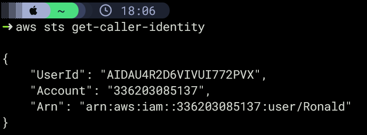

La respuesta confirma la autenticación del usuario IAM `Ronald` en la cuenta `336203085137`.

### 1.2 Configuración del Provider

En el archivo `provider.tf` se define el bloque de configuración con el provider oficial de AWS en su versión `6.70.0`:

```hcl
terraform {
  required_providers {
    aws = {
      source  = "hashicorp/aws"
      version = "6.70.0"
    }
  }
}

provider "aws" {
  region = "us-east-1"
}
```

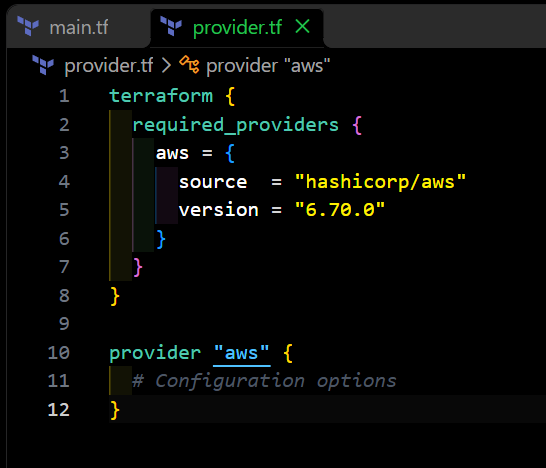

### 1.3 Inicialización con Terraform Init

Se ejecuta la inicialización del directorio de trabajo para descargar el plugin del proveedor:

```bash
terraform init
```

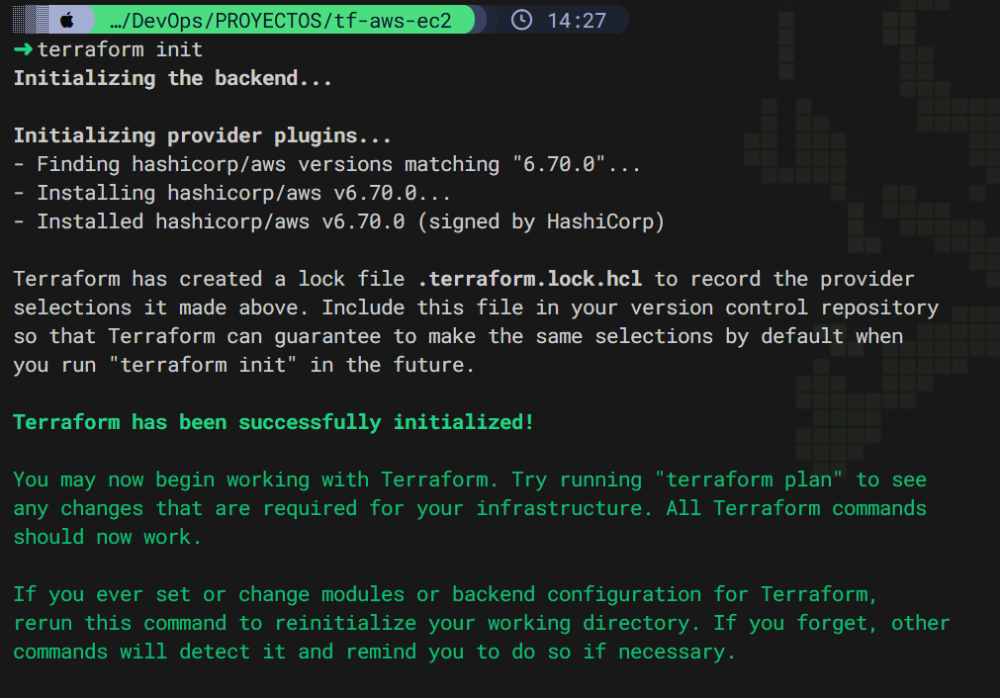

Terraform genera automáticamente el archivo de bloqueo `.terraform.lock.hcl`, garantizando la reproducibilidad de versiones de los proveedores en futuros despliegues.

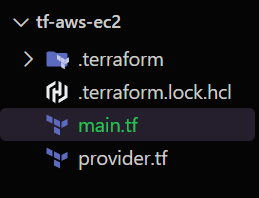

---

## Fase 2: Aprovisionamiento inicial de EC2 y Grupo de Seguridad

En la primera iteración se define la infraestructura base dentro de un único archivo `main.tf`, compuesto por:
1. Un **Security Group** con reglas de ingreso para HTTP (80) y HTTPS (443), y salida total hacia internet.
2. Una instancia de cómputo **EC2** de tipo `t3.micro` con AMI base de Ubuntu.

```hcl
# Security Group para la instancia EC2
resource "aws_security_group" "sg_ec2" {
  name        = "security_group_ec2"
  description = "Allow TLS inbound traffic and all outbound traffic"
  vpc_id      = "vpc-0e8a9965bfbed9d69"

  tags = {
    Name = "Security Group for EC2 instance"
  }
}

resource "aws_vpc_security_group_ingress_rule" "allow_tls_ipv4" {
  security_group_id = aws_security_group.sg_ec2.id
  cidr_ipv4         = "0.0.0.0/0"
  from_port         = 443
  ip_protocol       = "tcp"
  to_port           = 443
}

resource "aws_vpc_security_group_ingress_rule" "allow_http_ipv4" {
  security_group_id = aws_security_group.sg_ec2.id
  cidr_ipv4         = "0.0.0.0/0"
  from_port         = 80
  ip_protocol       = "tcp"
  to_port           = 80
}

resource "aws_vpc_security_group_egress_rule" "allow_all_traffic_ipv4" {
  security_group_id = aws_security_group.sg_ec2.id
  cidr_ipv4         = "0.0.0.0/0"
  ip_protocol       = "-1"
}

# Instancia EC2 básica
resource "aws_instance" "example" {
  ami                    = "ami-020ba0ae8c230ae28"
  instance_type          = "t3.micro"
  vpc_security_group_ids = [aws_security_group.sg_ec2.id]

  tags = {
    Name = "HelloWorld"
  }
}
```

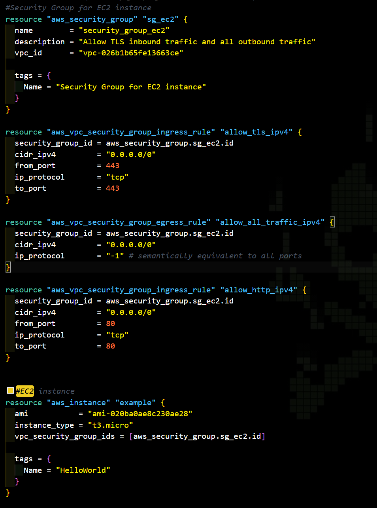

### 2.1 Validación y Formateo del Código

Antes de planificar el despliegue, se comprueba la sintaxis y se aplica el formato canónico de Terraform:

```bash
terraform fmt
terraform validate
```

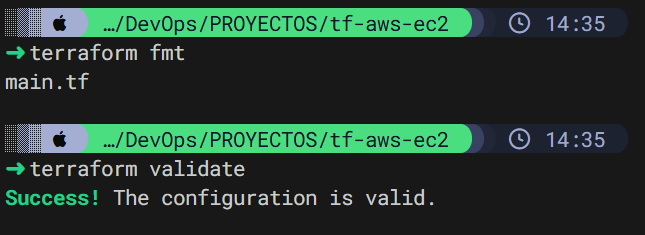

### 2.2 Planificación y Aplicación

Se ejecuta el comando `terraform plan` para evaluar los cambios requeridos sobre la cuenta de AWS:

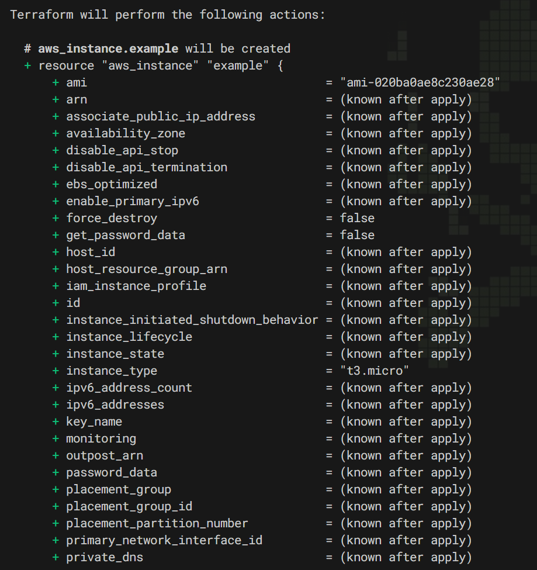
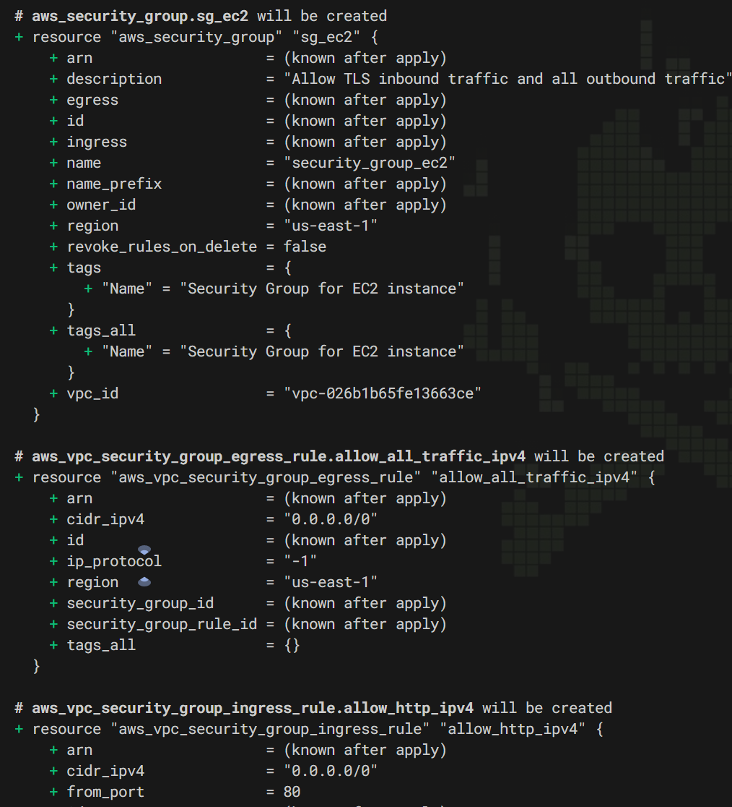

Posteriormente, se aplican los cambios confirmando con `yes`:

```bash
terraform apply
```

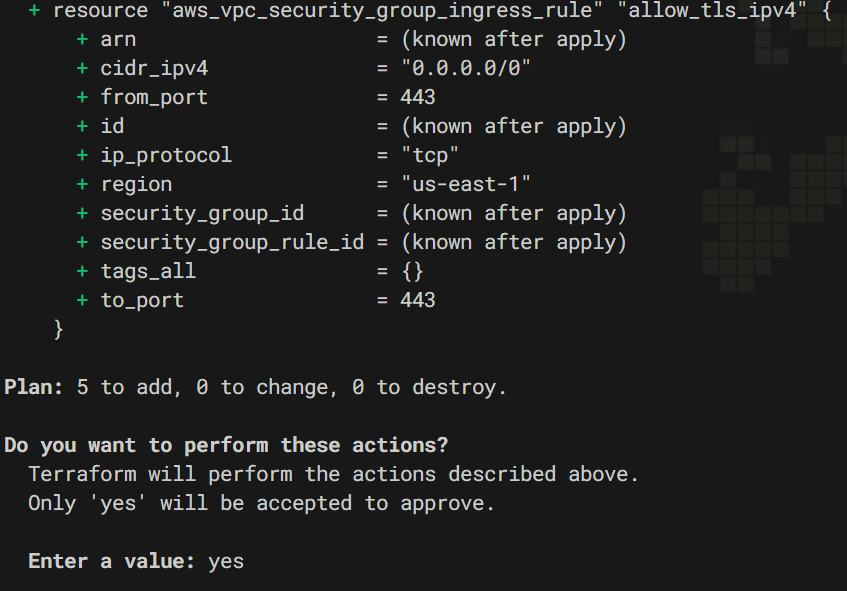
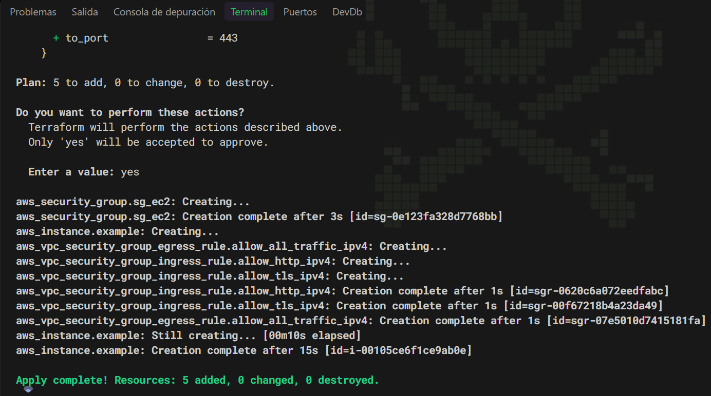

### 2.3 Verificación en la Consola de AWS

Se valida la creación exitosa de los recursos directamente en la consola web de AWS:

* **Instancia EC2 en estado `Running` con IP pública asignada:**
  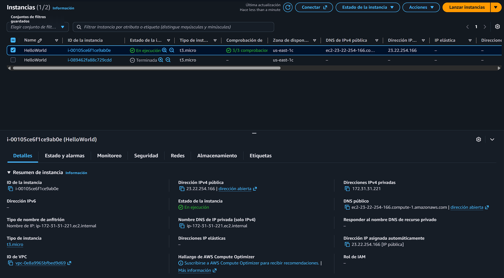

* **Security Group creado y asociado:**
  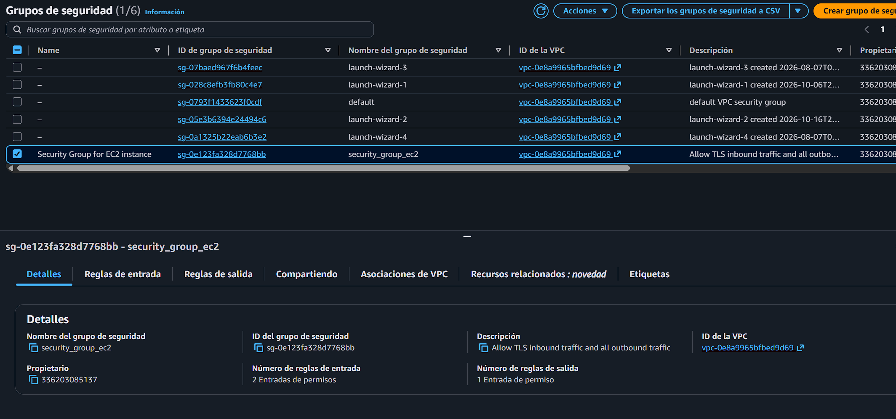

* **Reglas de entrada verificadas (puertos 80 y 443 TCP):**
  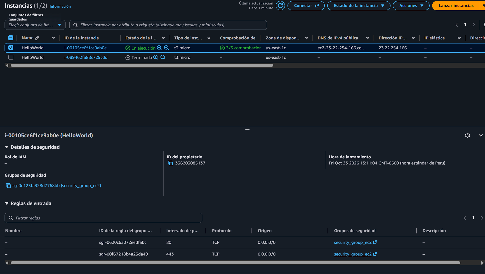

---

## Fase 3: Persistencia de Red con Elastic IP (EIP)

### 3.1 El Problema: Pérdida de IP Pública en cambios de infraestructura

Durante las pruebas se detectó que al realizar modificaciones en la instancia (por ejemplo, cambiar el `instance_type` de `t3.micro` a `t3.nano` o apagar la máquina), AWS desasigna la IP pública dinámica previa (`23.22.254.166`) y le asigna una nueva (`3.93.193.91`).

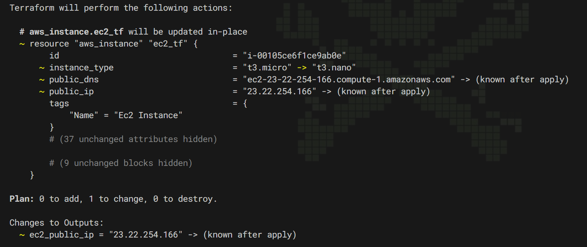
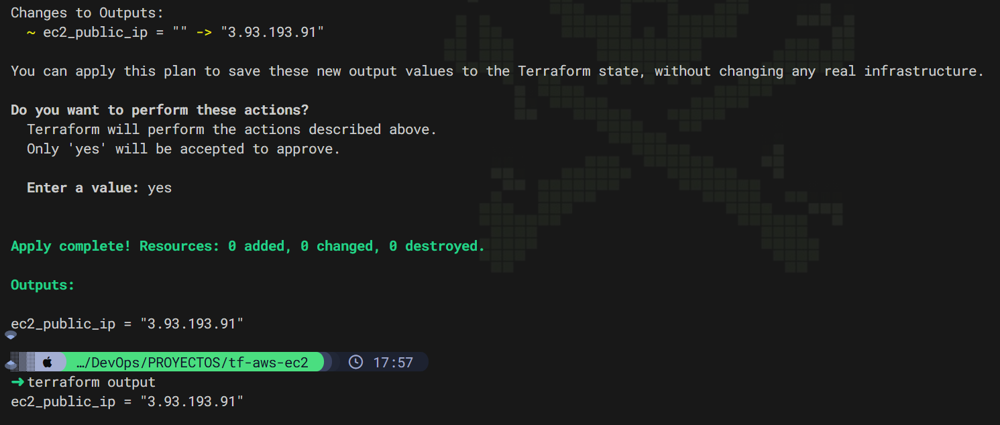

En entornos de producción o servidores web orientados al público, el cambio continuo de IP rompe registros DNS y certificados SSL.

### 3.2 Solución: Asignación de una Elastic IP

Para asegurar una dirección IPv4 estática e inmutable durante todo el ciclo de vida de la máquina, se incorpora el recurso `aws_eip`:

```hcl
resource "aws_eip" "eip" {
  instance = aws_instance.ec2_tf.id
}
```

Al aplicar los cambios, Terraform crea y asocia la Elastic IP:

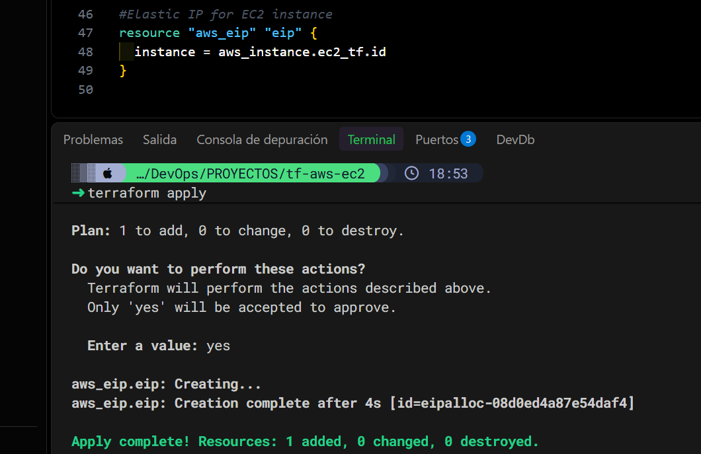

Comprobación en la consola de AWS: la instancia cuenta ahora con la dirección IP Elástica estática `52.200.4.171`:

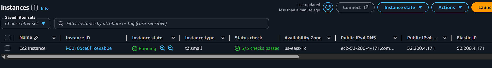

---

## Fase 4: Acceso Seguro sin SSH mediante AWS Systems Manager (SSM)

### ¿Por qué prescindir de SSH (Puerto 22)?

La administración tradicional por SSH requiere:
* Abrir el puerto 22 hacia internet (o rangos específicos), lo que expone el servidor a escaneos y ataques de fuerza bruta.
* Distribuir y rotar llaves privadas (`.pem` / `.pub`).
* Administrar usuarios locales en el sistema operativo.

Con **AWS Systems Manager (SSM) Session Manager**, la conexión se realiza a través de un canal HTTPS cifrado (puerto 443 saliente) hacia los endpoints de AWS, auditando todas las sesiones y comandos mediante IAM y AWS CloudTrail, sin necesidad de abrir ningún puerto de entrada.

### 5.1 Configuración de Roles y Políticas IAM

Para que la instancia EC2 pueda comunicarse con SSM, se define un rol IAM asumible por el servicio EC2, se le asocia la política administrada `AmazonSSMManagedInstanceCore` y se encapsula en un `aws_iam_instance_profile`:

```hcl
# Rol IAM para EC2
resource "aws_iam_role" "ec2_iam_role" {
  name = "ec2_iam_role"

  assume_role_policy = jsonencode({
    Version = "2012-10-17"
    Statement = [
      {
        Action = "sts:AssumeRole"
        Effect = "Allow"
        Principal = {
          Service = "ec2.amazonaws.com"
        }
      }
    ]
  })
}

# Asociación de política administrada de SSM
resource "aws_iam_policy_attachment" "ssm_policy_attachment" {
  name       = "ssm_policy_attachment"
  roles      = [aws_iam_role.ec2_iam_role.name]
  policy_arn = "arn:aws:iam::aws:policy/AmazonSSMManagedInstanceCore"
}

# Perfil de instancia para asociar el rol a la máquina
resource "aws_iam_instance_profile" "ec2_profile" {
  name = "aws_iam_instance_profile"
  role = aws_iam_role.ec2_iam_role.name
}
```

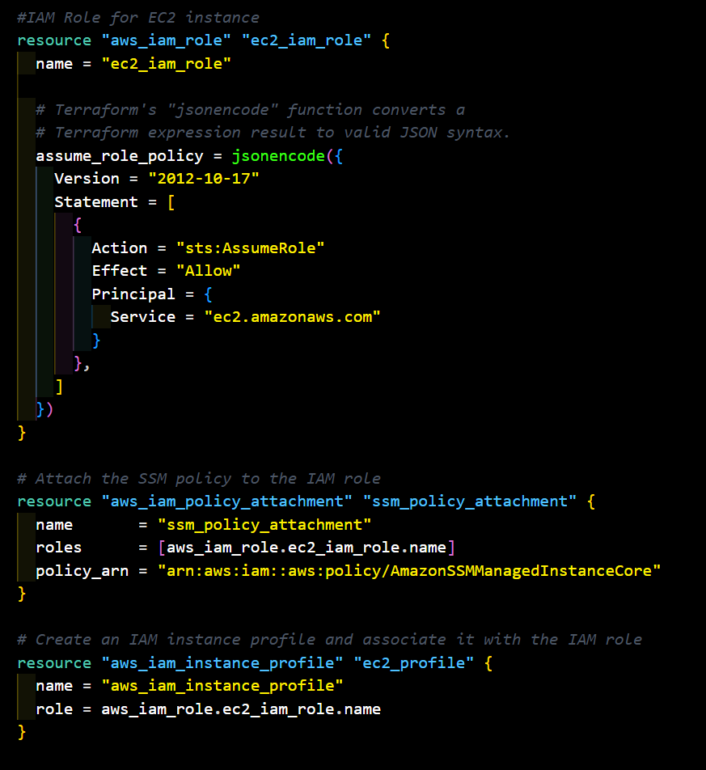
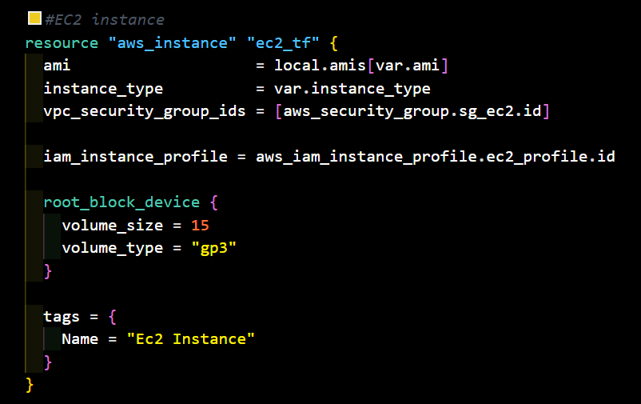

Se aplica la configuración con `terraform apply`:

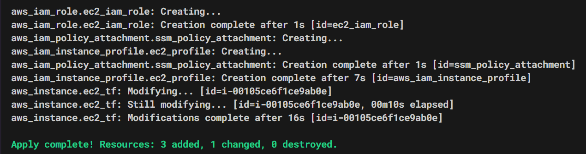

Verificación en la consola de IAM y en la propia instancia:

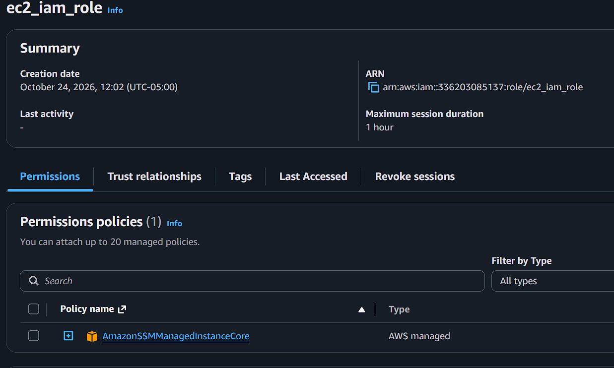
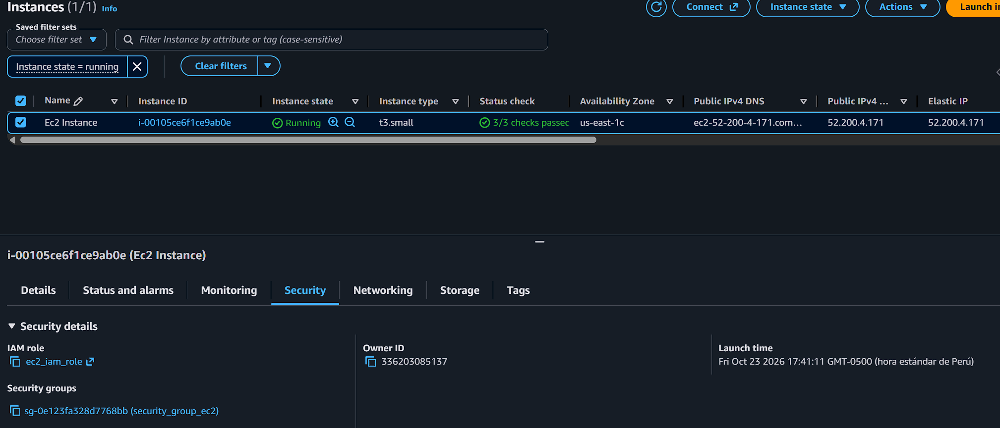

---

### 5.2 Diagnóstico del error en SSM Agent

Tras asignar el perfil IAM, al intentar abrir una sesión en la consola de AWS mediante Session Manager, el estado aparecía en **`Not connected`** con el siguiente mensaje de error:

```text
SSM Agent unable to acquire credentials: <error> no valid credentials could be retrieved for ec2 identity.
Default Host Management Err: error calling RequestManagedInstanceRoleToken: AccessDeniedException...
```

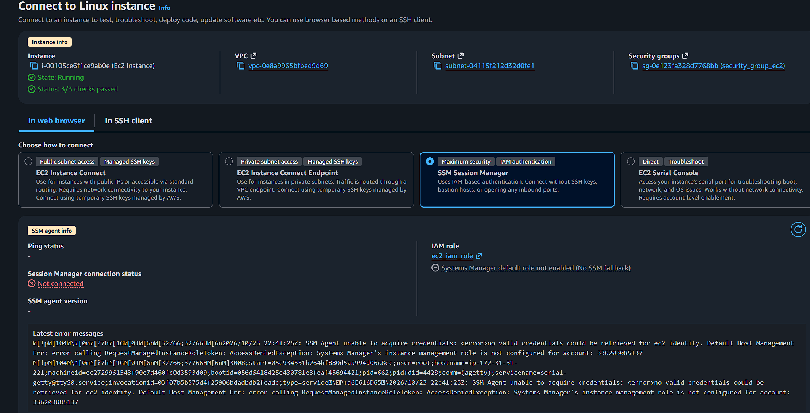

#### Causa Raíz Técnica:
1. **Estado del agente en la imagen:** En ciertas AMIs de Ubuntu o cuando el rol se añade a una instancia ya en marcha sin reiniciar el servicio, el agente SSM puede no estar instalado, encontrarse detenido o no haber refrescado las credenciales temporales proporcionadas por el servicio de metadatos de la instancia (*Instance Metadata Service - IMDS*).
2. **Ciclo de arranque:** El agente necesita inicializarse con el perfil IAM disponible desde su primer arranque para autenticar la identidad de la máquina contra los endpoints regionales de SSM.

---

### 5.3 Bootstrapping con User Data y Reemplazo de Instancia

Para solucionar el problema de raíz y garantizar que cualquier instancia nueva quede 100% operativa automáticamente, se implementa un script de inicialización (`scripts/agent_ssm.sh`):

```bash
#!/bin/bash

echo "Updating system packages..."
apt-get update -y 
apt-get upgrade -y

echo "Installing Nginx for ${web_app}..."
apt-get install -y nginx
systemctl enable nginx & systemctl start nginx

echo "Installing Amazon SSM Agent..."
snap install amazon-ssm-agent --classic
snap start amazon-ssm-agent
```

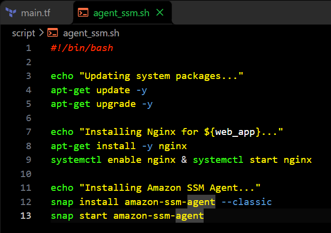

En el recurso `aws_instance` se asocia el script utilizando `templatefile()` y se activa el parámetro **`user_data_replace_on_change = true`**:

```hcl
resource "aws_instance" "ec2_tf" {
  ami                         = local.amis[var.ami]
  instance_type               = var.instance_type
  vpc_security_group_ids      = [aws_security_group.sg_ec2.id]
  iam_instance_profile        = aws_iam_instance_profile.ec2_profile.id

  user_data                   = templatefile("${path.module}/scripts/agent_ssm.sh", { web_app = "My Web App" })
  user_data_replace_on_change = true

  tags = {
    Name = "${var.project_name}-Ec2 Instance"
  }
}
```

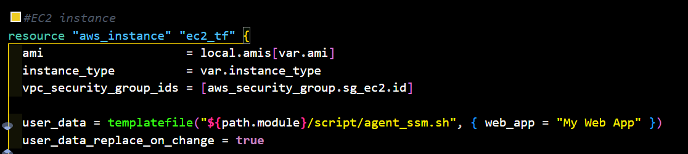

> **Importante:** La propiedad `user_data_replace_on_change = true` instruye a Terraform a destruir y recrear la instancia si el contenido del script de bootstrapping cambia, asegurando que el servidor se configure limpiamente desde su creación inicial.

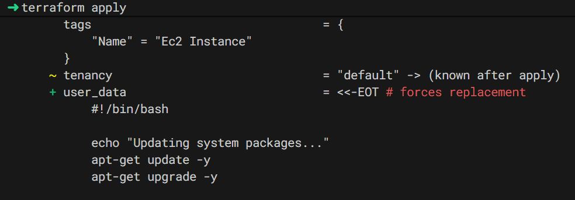

---

### 5.4 Conexión exitosa por Session Manager

Una vez recreada la instancia con el script ejecutado durante el boot:
* El agente SSM se registra automáticamente.
* El estado de conexión cambia a **`Connected`** y el ping a **`Online`**.
* Es posible abrir una terminal interactiva de Linux directamente desde el navegador, con privilegios de root, sin llaves SSH ni puertos abiertos.

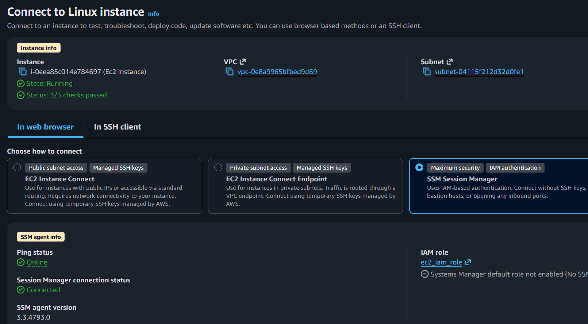

---

## Fase 5: Refactorización y Diseño de Módulos Propios

Con el objetivo de seguir las mejores prácticas de la industria y el principio DRY (*Don't Repeat Yourself*), se desacopla el código monolítico convirtiéndolo en un **módulo reutilizable**.

### 5.1 Estructura del módulo local

Se organiza el proyecto separando responsabilidades:

```text
tf-aws-ec2/
├── modules/
│   └── ec2/
│       ├── locals.tf
│       ├── main.tf
│       ├── outputs.tf
│       └── variables.tf
├── scripts/
│   └── agent_ssm.sh
├── main.tf
├── provider.tf
├── terraform.tfvars
└── .gitignore
```

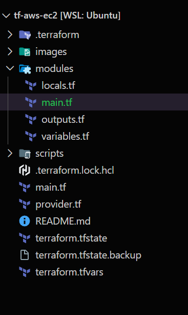

### 5.2 Parametrización y uso de templatefile

En `modules/ec2/locals.tf` se define un mapa de AMIs para desacoplar el sistema operativo:

```hcl
locals {
  amis = {
    amazon = "ami-08c46876c64a927b8"
    macOs  = "ami-0531fecfb292182a3"
    ubuntu = "ami-0d97d7f07b25dd693"
  }
}
```

En `modules/ec2/variables.tf` se exponen los parámetros configurables (`project_name`, `instance_type`, `ami`, `volumen_size`, `user_data`), permitiendo nombrar dinámicamente los recursos con `${var.project_name}` para evitar colisiones:

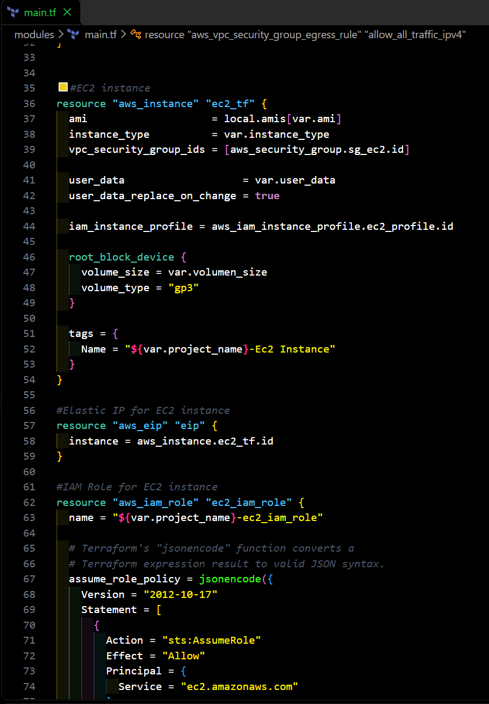

En el `main.tf` raíz se invoca el módulo limpio:

```hcl
module "ec2_intance_v1" {
  source        = "./modules/ec2"
  project_name  = "Roweb"
  instance_type = "t3.micro"
  ami           = "ubuntu"
  volumen_size  = 10
  user_data     = templatefile("${path.module}/scripts/agent_ssm.sh", { web_app = "My Web App" })
}
```

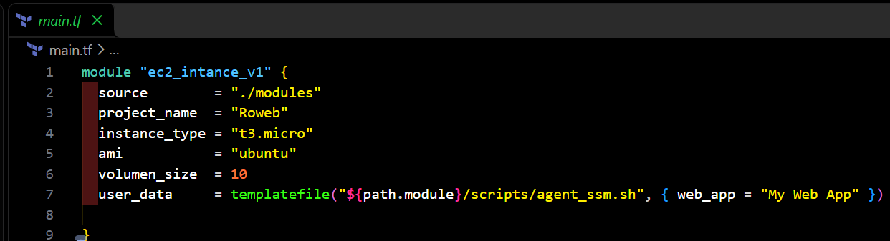

Se descarga el módulo local mediante `terraform init`:

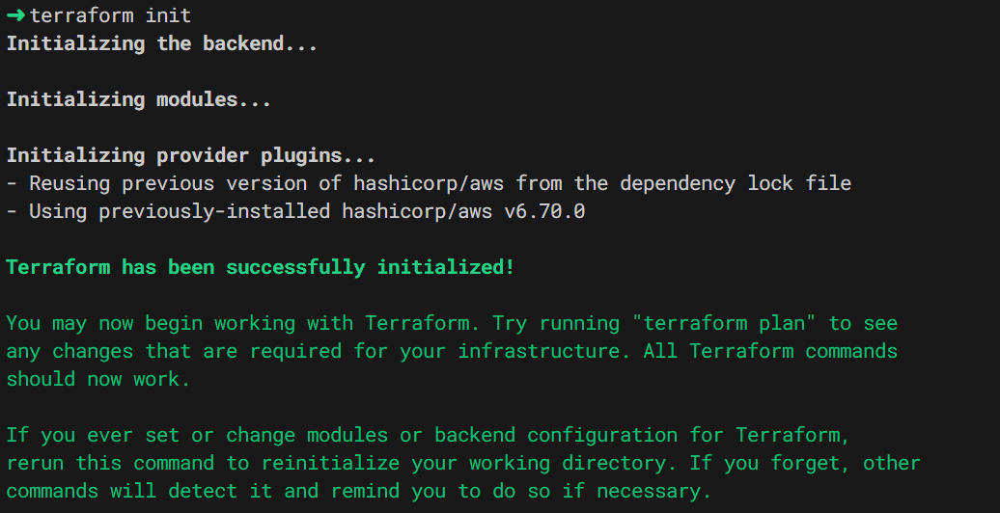

Se aplica el despliegue creando los 9 recursos del módulo (Security Group, reglas, IAM Role, Policy Attachment, Instance Profile, EC2 y Elastic IP):

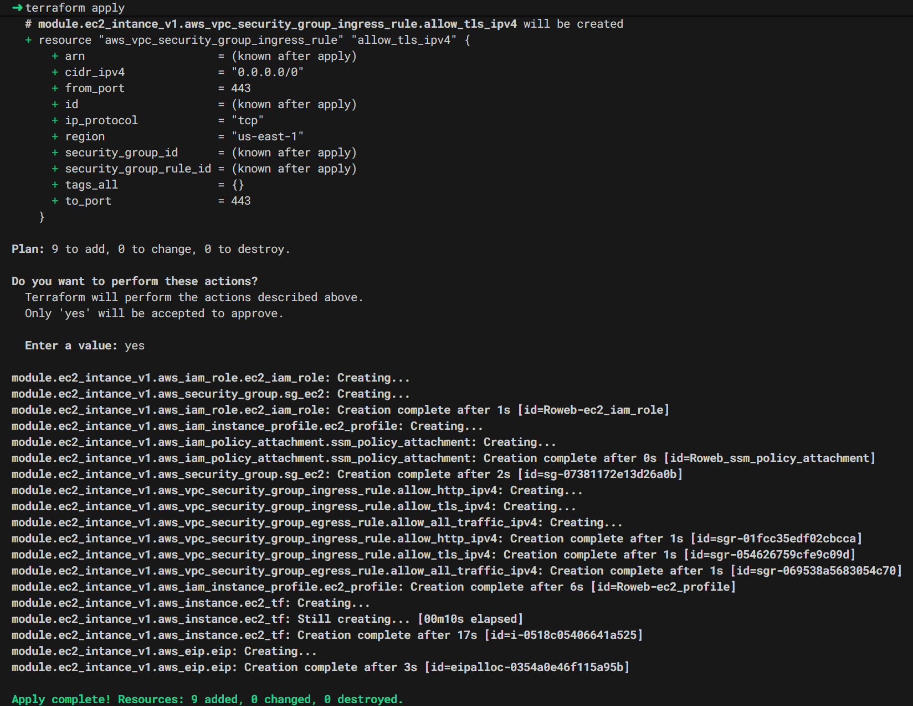

Verificación en la consola de AWS: la instancia `Roweb-Ec2 Instance` y su grupo `Roweb-security_group_ec2` se despliegan con la nomenclatura solicitada:

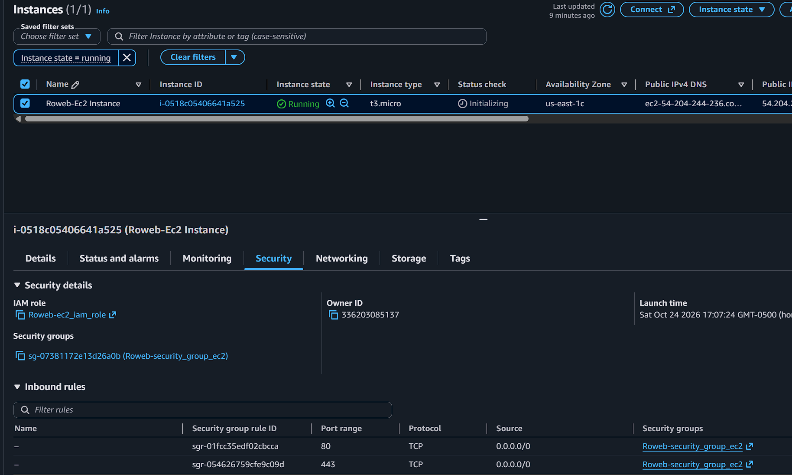
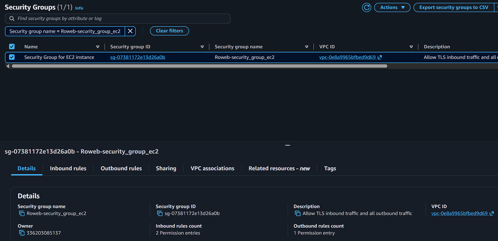

---

### 5.3 Despliegue y escalabilidad con múltiples instancias

Para evidenciar la reusabilidad del módulo, se declara una segunda instancia (`Roweb2`) con diferente tipo de máquina y volumen dentro del mismo `main.tf`:

```hcl
module "ec2_intance_v2" {
  source        = "./modules/ec2"
  project_name  = "Roweb2"
  instance_type = "t3.small"
  ami           = "ubuntu"
  volumen_size  = 8
  user_data     = templatefile("${path.module}/scripts/agent_ssm.sh", { web_app = "My Web App_2" })
}
```

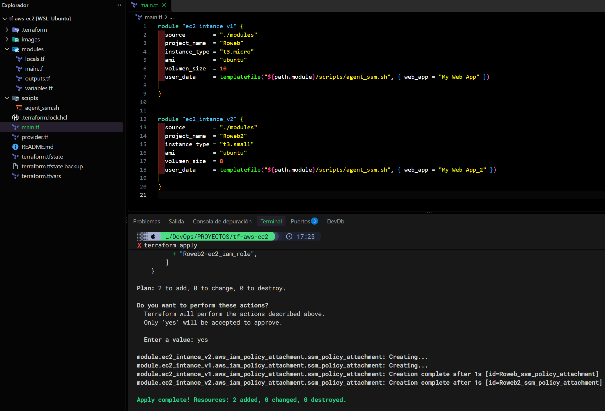

Ambas instancias coexisten en la cuenta de AWS con sus configuraciones independientes:

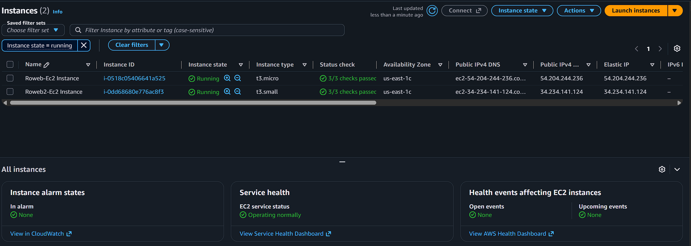

---

## Fase 6: Integración con Módulos del Terraform Registry

Además de módulos personalizados, es una práctica común en proyectos empresariales consumir módulos mantenidos por la comunidad desde el **Terraform Registry**, tales como `terraform-aws-modules/ec2-instance/aws`.

Se añade al `main.tf` raíz la invocación de este módulo externo para desplegar una instancia en una subnet específica:

```hcl
module "ec2_instance" {
  source        = "./modules/ec2_instance"  # Módulo oficial vendorizado localmente
  name          = "instance_module_external"
  instance_type = "t3.micro"
  subnet_id     = "subnet-07b4d4cd775588a4b"
  ami           = "ami-0d97d7f07b25dd693"
}
```

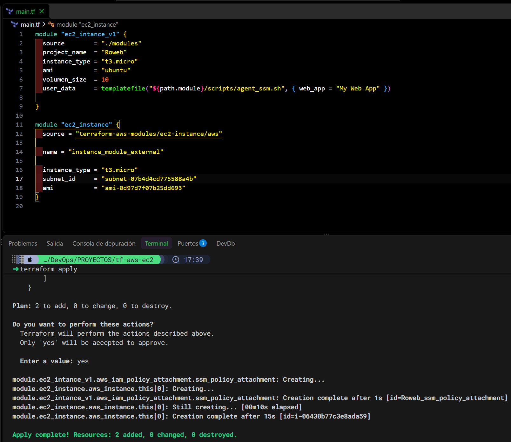

Comprobación en la consola de AWS: la instancia `instance_module_external` se aprovisiona correctamente junto con las demás:

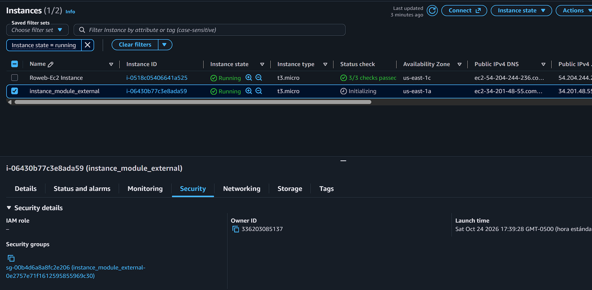

---

## Fase 7: Versionado seguro en Git y Publicación en GitHub

### 7.1 Protección del Estado y Datos Sensibles (.gitignore)

Los archivos `.tfstate` contienen metadatos y potencialmente valores confidenciales en texto plano. Asimismo, el directorio `.terraform/` contiene binarios descargados innecesarios para el repositorio.

Tomando como referencia la plantilla oficial de GitHub para Terraform:


Se crea el archivo `.gitignore` protegiendo:
* Caché de proveedores (`.terraform/`)
* Archivos de estado (`*.tfstate`, `*.tfstate.*`)
* Variables de entorno con posibles secretos (`*.tfvars`, `*.tfvars.json`)
* Archivos de bloqueo de ejecución (`.terraform.tfstate.lock.info`)

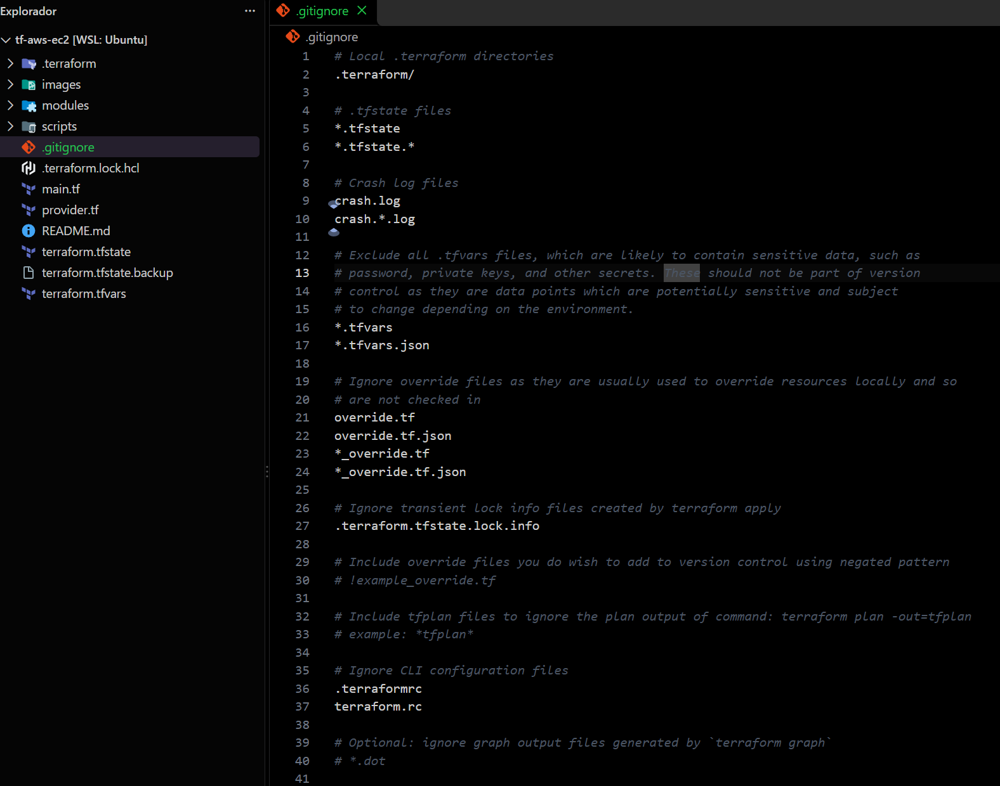

### 7.2 Repositorio Final en GitHub

El proyecto queda publicado con un historial limpio y estructurado en GitHub:

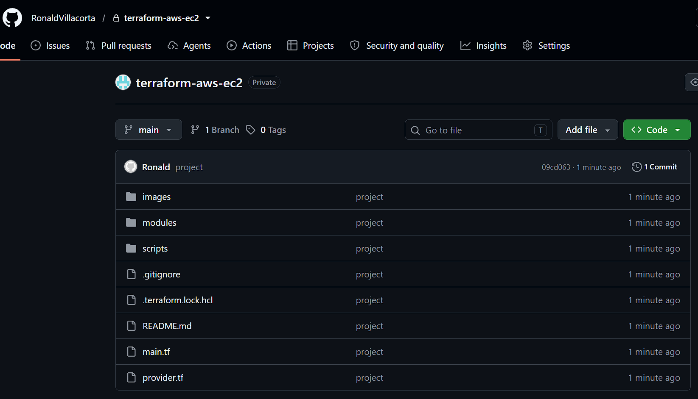

---

## Estructura del Proyecto

A continuación se detalla la estructura final de archivos y su propósito:

```text
tf-aws-ec2/
├── .gitignore                          # Exclusiones de Git (estados, secretos, cachés)
├── .terraform.lock.hcl                 # Bloqueo determinista de versiones de providers
├── README.md                           # Documentación técnica completa del proyecto
├── main.tf                             # Orquestación raíz de módulos de infraestructura
├── provider.tf                         # Declaración del provider de AWS y versiones
├── terraform.tfvars                    # Variables del entorno local
├── images/                             # Evidencias visuales y diagramas
├── scripts/
│   └── agent_ssm.sh                    # Bootstrapping (Nginx + AWS SSM Agent)
└── modules/
    ├── ec2/                            # Módulo personalizado reutilizable
    │   ├── locals.tf                   # Mapa de AMIs por SO
    │   ├── main.tf                     # Recursos EC2, SG, EIP, IAM Role y Profile
    │   ├── outputs.tf                  # Salidas exportables (IP pública)
    │   └── variables.tf                # Parámetros de entrada configurables
    └── ec2_instance/                   # Módulo comunitario oficial vendorizado
```

### Tabla descriptiva de componentes

| Archivo / Carpeta | Propósito |
|---|---|
| `main.tf` | Punto de entrada que orquesta los módulos `ec2_intance_v1` y `ec2_instance`. |
| `provider.tf` | Configura el proveedor `hashicorp/aws` fijado en la versión `6.70.0`. |
| `scripts/agent_ssm.sh` | Script bash de inicialización inyectado mediante `templatefile()`. |
| `modules/ec2/main.tf` | Define la infraestructura completa: EC2, Grupo de Seguridad, EIP y Roles IAM. |
| `modules/ec2/variables.tf` | Permite parametrizar el módulo (nombre, tamaño de disco, tipo de instancia). |
| `modules/ec2/locals.tf` | Mapeo asociativo de IDs de AMI por distribución (`ubuntu`, `amazon`, `macOs`). |
| `modules/ec2/outputs.tf` | Expone atributos calculados como la IP pública resultante. |
| `modules/ec2_instance/` | Módulo oficial de la comunidad de Terraform Registry para cómputo EC2. |
| `.gitignore` | Evita la fuga accidental de secretos (`.tfvars`) y estados (`.tfstate`). |

---

## Decisiones Técnicas Relevantes

| Decisión Técnica | Justificación y Beneficio |
|---|---|
| **Acceso por AWS SSM Session Manager** | Elimina la necesidad de abrir el puerto 22 hacia internet y la administración de llaves SSH privadas (`.pem`), mejorando la postura de seguridad. |
| **Uso de Elastic IP (EIP)** | Evita que la dirección IP pública cambie tras un reinicio, detención o cambio de tipo de instancia de EC2. |
| **`user_data_replace_on_change = true`** | Asegura que cualquier cambio en el script de bootstrapping fuerce un reemplazo limpio de la máquina, garantizando infraestructura inmutable. |
| **Mapeo de AMIs en `locals.amis`** | Permite seleccionar el sistema operativo de forma legible (`ubuntu`, `amazon`) sin quemar IDs de AMI en el código principal. |
| **Nomenclatura con `${var.project_name}`** | Facilita la reutilización del módulo múltiples veces en la misma cuenta sin colisiones de nombres en IAM ni Security Groups. |
| **Fijación de versión del Provider (`6.70.0`)** | Previene que actualizaciones menores o mayores del provider introduzcan cambios que rompan la sintaxis. |
| **`.gitignore` canónico de Terraform** | Protege el repositorio contra la subida accidental de archivos de estado con datos confidenciales o variables sensibles. |

---

## Problemas Encontrados y Lecciones Aprendidas (Troubleshooting)

### 1. Pérdida de IP pública tras modificaciones
* **Problema:** Al alterar el tamaño de la instancia (`instance_type`), la máquina cambiaba de IP pública, rompiendo la conectividad con clientes.
* **Solución:** Se implementó una **Elastic IP** (`aws_eip`) vinculada al `instance_id`, garantizando que la dirección IP pública se mantenga fija independientemente del ciclo de vida de la máquina.

### 2. Error de conexión en SSM: *SSM Agent unable to acquire credentials*
* **Problema:** Tras asociar el rol IAM a la instancia, la consola de Session Manager mostraba `Not connected` con error de credenciales.
* **Solución:** Se constató que la instancia requería tener el agente SSM explícitamente instalado e inicializado desde el arranque para negociar el token de credenciales temporales con el servicio de metadatos (`IMDS`). Se automatizó mediante `agent_ssm.sh` vía `snap` y se forzó el reemplazo de la máquina con `user_data_replace_on_change = true`.

### 3. Recreación automática con `user_data_replace_on_change`
* **Problema:** Por defecto, modificar el `user_data` en Terraform no altera una instancia ya en ejecución, lo que provocaba que cambios en el script no tuvieran efecto.
* **Solución:** Al activar `user_data_replace_on_change = true`, Terraform detecta cambios en el script de arranque y ejecuta automáticamente una estrategia de destrucción y recreación controlada (*Replace*).

### 4. Inicialización obligatoria de módulos locales
* **Problema:** Al mover la infraestructura a `modules/ec2`, los comandos `plan` y `apply` fallaban indicando que el módulo no estaba instalado.
* **Solución:** Cada vez que se añade un nuevo bloque `module` local o remoto, es indispensable volver a ejecutar `terraform init` para que Terraform construya el árbol de módulos dentro de `.terraform/modules/`.

---

## Posibles Mejoras y Roadmap

Para elevar esta infraestructura hacia un estándar 100% de producción empresarial, se sugieren los siguientes siguientes pasos:

1. **Backend Remoto en Amazon S3 + DynamoDB:**  
   Migrar el almacenamiento del archivo `terraform.tfstate` hacia un bucket S3 con cifrado SSE, versionamiento y bloqueo de estado concurrente con DynamoDB.
2. **Pipeline de CI/CD con GitHub Actions:**  
   Automatizar la ejecución de `terraform fmt -check`, `terraform validate` y `terraform plan` en Pull Requests, y `terraform apply` únicamente tras la aprobación de merge a `main`.
3. **Autenticación Federada mediante OpenID Connect (OIDC):**  
   Configurar GitHub Actions con AWS OIDC y un IAM Role con permisos mínimos, eliminando el uso de credenciales estáticas de larga duración (`AWS_ACCESS_KEY_ID`).
4. **Alta Disponibilidad y Balanceo de Carga:**  
   Reemplazar la instancia individual por un **Auto Scaling Group (ASG)** distribuido en múltiples zonas de disponibilidad, respaldado por un **Application Load Balancer (ALB)**.
5. **Análisis de Seguridad y Cumplimiento IaC:**  
   Incorporar herramientas de análisis estático como **Trivy**, **Checkov** o **tfsec** en el pipeline para detectar vulnerabilidades en grupos de seguridad y permisos de IAM antes del despliegue.

---

## Referencias

- [Terraform Documentation — AWS Provider](https://registry.terraform.io/providers/hashicorp/aws/latest/docs)
- [AWS Systems Manager — Session Manager](https://docs.aws.amazon.com/systems-manager/latest/userguide/session-manager.html)
- [Terraform Registry — AWS EC2 Instance Module](https://registry.terraform.io/modules/terraform-aws-modules/ec2-instance/aws/latest)
- [GitHub Gitignore Templates — Terraform](https://github.com/github/gitignore/blob/main/Terraform.gitignore)
